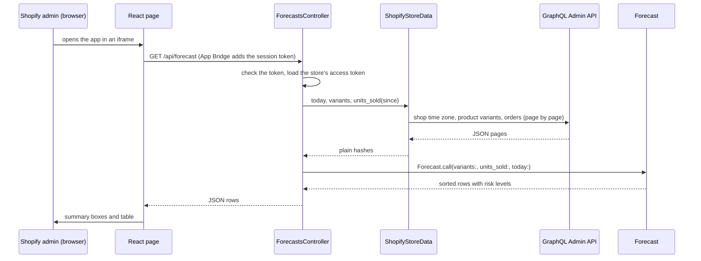

# Architecture

How Restock Forecaster is put together, and why. For setup and features, see the [README](../README.md); for a file-by-file walkthrough, see the [study guide](study-guide.md).

## The pieces

| Piece | Where | Job |
|---|---|---|
| React page | `web/frontend/pages/index.tsx` | The at-risk table, the summary boxes and the Refresh button |
| Sales window | `web/frontend/components/SalesHistoryModal.tsx`, `SalesChart.tsx` | Days left, the three tabs and the SVG chart for one product |
| API shapes | `web/frontend/types.ts` | TypeScript types for the JSON the Rails endpoints send |
| Controller | `web/app/controllers/forecasts_controller.rb` | `GET /api/forecast` and `GET /api/sales_history` |
| Store reader | `web/app/services/shopify_store_data.rb` | All GraphQL queries and pagination; turns Shopify's answers into plain Ruby hashes |
| Forecast | `web/app/services/forecast.rb` | The math: daily rate, days left, risk level, sort order. No Shopify code. |
| Sales history | `web/app/services/sales_history.rb` | Groups one product's daily sales into 7-day, 30-day and 8-week ranges. No Shopify code. |
| Seed | `web/app/services/seed_scenario.rb`, `web/lib/tasks/restock.rake` | The demo store's products and backdated orders, and the task that writes them to Shopify |

The `shopify_app` gem (from Shopify's Ruby template) handles installing the app, the store's login token, and webhooks.

## One request, start to finish



Clicking a risk badge follows the same path to `GET /api/sales_history?variant_id=…`. That reads 8 weeks of orders through `ShopifyStoreData#daily_units` and groups them with `SalesHistory`.

## The GraphQL queries

All three live in `web/app/services/shopify_store_data.rb`.

**Products.** Only active products, and only variants that track inventory (filtered in Ruby):

```graphql
query($after: String, $query: String) {
  productVariants(first: 250, after: $after, query: $query) {
    nodes { id title sku inventoryQuantity inventoryItem { tracked } product { title productType } }
    pageInfo { hasNextPage endCursor }
  }
}
```

It runs with `query: "product_status:active"`. `productType` is the Category column.

**Orders.** Filtered on `processed_at`, the time of the sale, not `created_at`, so backdated demo orders land on the right day:

```graphql
query($after: String, $query: String) {
  orders(first: 250, after: $after, query: $query) {
    nodes { cancelledAt processedAt lineItems(first: 250) { nodes { quantity variant { id } } } }
    pageInfo { hasNextPage endCursor }
  }
}
```

It runs with `query: "processed_at:>=YYYY-MM-DD"`. Cancelled orders and line items without a variant (custom items, deleted products) are skipped.

**The store's time zone:** `{ shop { ianaTimezone } }`. "Today" and each sale's date are worked out on the store's calendar, not the server's (Rails runs in UTC).

**Pagination.** Both lists are read 250 at a time. While `pageInfo.hasNextPage` is true, the next request passes `pageInfo.endCursor` as `after` (cursor pagination).

## Decisions

**Computed on every request, nothing stored.** The app keeps no copy of products or orders. Each page load asks Shopify again, so the numbers are always current, and nothing can drift out of step. The alternative, keeping a local copy up to date with webhooks and background jobs, adds a database, jobs and failure modes that one small store doesn't need. The cost is that each load reads every order from the last 30 days; at a much larger store that would be the first thing to change.

**30 days of sales.** Long enough to smooth out quiet days, short enough to follow a change in demand within a month. Shopify lets apps read the last 60 days of orders without special approval, so 30 days fits comfortably. The sales chart's longest range, 8 weeks (56 days), was chosen for the same reason: a year would need the `read_all_orders` permission, which Shopify must approve.

**The thresholds, 7 and 14 days.** About one and two weeks of stock, a typical reorder rhythm for a small shop. They sit in two lines of `Forecast#risk`, so they're easy to change.

**Plain Ruby for the math.** `Forecast` and `SalesHistory` take plain hashes and dates and know nothing about Shopify, so their tests need no API stubs.

## Error handling

- **Shopify fails** (down, rate-limited, or returns GraphQL errors). `ShopifyStoreData` raises `ShopifyStoreData::Error`, and the HTTP client raises `ShopifyAPI::Errors::HttpResponseError`. One `rescue_from` in `ForecastsController` turns both into `502 Bad Gateway` with `{ "error": "Couldn't load data from Shopify. Try again." }`. The real error goes to the server log only.
- **The store's access token was rejected** (`401`), for example after a reinstall. `with_token_refetch` from `shopify_app` swaps the session token for a fresh access token and retries once before giving up.
- **No `variant_id` on `/api/sales_history`.** `params.require` answers `400 Bad Request`. The id is only compared with ids that came from Shopify, so it isn't format-checked.
- **In the browser,** `fetchJson` turns any failure into an `Error`, including a request that never reached the server. The page then shows a red banner with a Retry button. If a refresh fails after a good load, the old table stays on screen under the banner.
